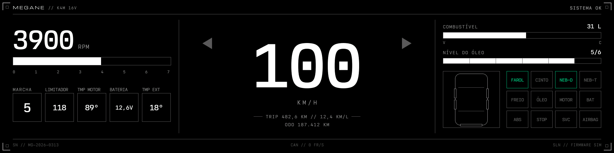
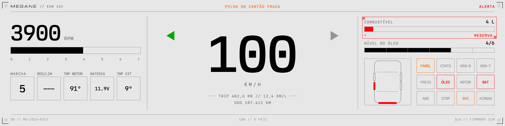

# x84-digidash-cpp

[Português](README.pt-BR.md)

A digital instrument cluster for the Renault Mégane II (X84 platform), written in C++ with LVGL. It runs on a
Waveshare ESP32-P4 board with an 8.8" DSI display (480x1920, portrait) used in landscape (1920x480), and reads the
car's CAN bus in listen-only mode: it never transmits.

It is the C++ version of the Rust + Slint project `x84-digidash`: same screen, same CAN decoding, about twice the
frame rate.




## Features

- Engine speed with a bar and a red line, road speed, gear (debounced), cruise control and speed limiter.
- Coolant temperature, battery voltage and outside temperature; fuel level with a reserve alert; oil level.
- Open doors and trunk on a top view of the car; turn signals.
- Twelve warning lights (headlights, seat belt, front and rear fog lights, brake, oil, engine, battery, ABS, STOP,
  service, airbag), steady or blinking as the car sends them.
- The cluster's text messages in the header, with their severity.
- Trip distance and fuel economy, kept across restarts (NVS), and the odometer.
- Day and night: with the low or high beam on, a dark theme at 70 % backlight; otherwise a light theme at 100 %.
- CAN status in the footer: frames per second, bus errors, bus-off or silence.
- 50 to 61 fps in the worst case (every digit changing every frame); about 0.9 MB of firmware.

## Hardware

- [Waveshare ESP32-P4 board](https://www.waveshare.com/) with the 8.8" MIPI-DSI display (OTA7290B controller).
- A 3.3 V CAN transceiver wired to GPIO3 (TX) and GPIO2 (RX), on the car's 500 kbit/s bus. The controller runs in
  listen-only mode.

## Building

Requires [ESP-IDF 6.0.2](https://docs.espressif.com/projects/esp-idf/en/v6.0.2/esp32p4/get-started/). `./idf.sh`
loads it and calls `idf.py` (edit the paths in it to match your installation):

```sh
./idf.sh build                         # firmware reading the car's CAN bus
./idf.sh -p /dev/cu.usbmodem… flash    # flash it (ls /dev/cu.usbmodem* to find the port)
./idf.sh -p /dev/cu.usbmodem… monitor  # serial log (Ctrl+] quits)
```

On the bench, without the car, the screen shows `--` and "SEM CAN" (no CAN). To see simulated data instead (the
three scenarios of the design every 12 s, switching between night and day after each round), build the
simulation variant, in `build-sim/`:

```sh
./idf.sh -B build-sim -D SDKCONFIG=build-sim/sdkconfig -D "SDKCONFIG_DEFAULTS=sdkconfig.defaults;sdkconfig.simulation" build flash
```

## On the computer

A desktop simulator (SDL2: `brew install sdl2` on macOS) and the CAN decoding tests, without the board:

```sh
cmake -S sim -B sim/build && cmake --build sim/build
sim/build/dashboard-sim                                    # window with the simulation
sim/build/dashboard-sim --screenshot out.png 1             # scenario 1 (0 normal, 1 warning, 2 low fuel) as PNG
sim/build/dashboard-sim --screenshot out.png 1 light       # the same by day

cmake -S components/x84_can/test -B components/x84_can/test/build
cmake --build components/x84_can/test/build && components/x84_can/test/build/x84_can_test
```

## Layout

- `components/ui/`: the screen, in LVGL. Only it draws; the rest of the firmware hands a `Screen` (`screen.h`) to
  `Dashboard::show` (`dashboard.h`).
  - `theme.h`: colors (dark and light palettes), type scale, gauge scales and layout rulers.
  - `base.h`: building blocks (box, outline, text, image) and setters that only touch LVGL when a value changes.
  - `widgets/`: reusable pieces (bars, value boxes, warning lights, alert frame, doors, turn signals).
  - `panels/`: the frame (corners, header, footer) and the three columns, built from the widgets.
  - `simulation.cpp`: fake data for the bench and the simulator.
  - `fonts/` and `images/`: generated by `tools/` (do not edit by hand).
- `components/x84_can/`: the car's CAN bus, in plain C++ (it also builds on the computer, for the tests).
  - `frames.h`: where each signal sits and one decoder per frame. `view.cpp`: what the screen shows from the frames.
    `trip.h`: trip distance and fuel.
  - `test/`: the tests, checked against `can/signals-x84.json`.
- `main/`: the board. `display.cpp` (display and LVGL), `can.cpp` (TWAI, listen-only), `vehicle.cpp` (frames to
  `Screen`, trip in NVS), `intro.cpp` (backlight fade-in), `main.cpp` (wires it all).
- `sim/`: the desktop simulator. `tools/`: font and image converters.

## Common changes

- **A color or a text size:** `components/ui/theme.h`.
- **A new font size:** a line in `tools/fonts.sh`, run it, declare the font in `components/ui/fonts.h` and add the
  `theme::Font` in `theme.h`.
- **A new image:** the SVG in `assets/images/`, then `cd tools && npm install && node images.mjs`, and declare it
  in `components/ui/images.h`.
- **Moving something on screen:** the positions are named constants at the top of each file in `panels/`.
- **A new file** (`.cpp`, font or image): the `CMakeLists.txt` files find sources by folder, but only when
  configuring. After adding one, run `./idf.sh reconfigure build` (and `cmake -S sim -B sim/build`).
- Check in the simulator before flashing: `cmake --build sim/build && sim/build/dashboard-sim --screenshot out.png 2`.

## Editor

`.clangd` already drops the board's GCC flags clang does not know. For clangd to find the board compiler's headers,
add `"clangd.arguments": ["--query-driver=**/riscv32-esp-elf-*"]` to your VS Code user settings and run
`./idf.sh build` once (it writes `build/compile_commands.json`).

## Credits

- [LVGL](https://lvgl.io/) (MIT), [ESP-IDF](https://github.com/espressif/esp-idf) and the Waveshare board support
  package (Apache 2.0).
- [Nordwand Mono](https://github.com/tywr/Nordwand-Mono) (SIL Open Font License 1.1, `assets/fonts/OFL.txt`); the
  "MEGANE" wordmark is drawn from [Michroma](https://fonts.google.com/specimen/Michroma) (SIL Open Font License).
- Tests: [doctest](https://github.com/doctest/doctest) and [nlohmann/json](https://github.com/nlohmann/json) (MIT).
  Simulator screenshots: [stb](https://github.com/nothings/stb) (public domain / MIT).

Renault and Mégane are trademarks of Renault. This is an independent project, not affiliated with or endorsed by
Renault.

## License

To be defined.
